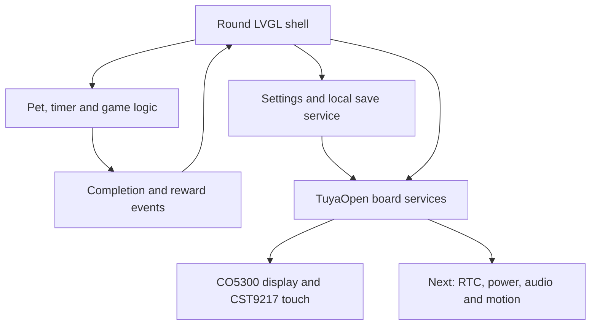

# Pebble microOS — product blueprint

Prepared for Anz · 23 November 2026 · working concept and engineering alpha

## The product in one sentence

**A tiny offline companion that grows when you make time for yourself.**

The hook should be visible in five seconds: you tap a round little face, it reacts, and it keeps you company through a focus session. The games make it approachable; the relationship and usefulness give people a reason to return.

This is a product shell on an existing embedded runtime, not a new general-purpose operating-system kernel. The first target is your existing Waveshare Tuya T5 board. Avoid introducing cloud AI into the first release: the core experience can be responsive, private and inexpensive using local state machines.

## Who it is for

Start with adults who already enjoy desk accessories, virtual pets, cozy games and focus timers. Your first recruits can be colleagues and maker communities interested in a playful desk companion. Treat younger users as a separate later product-design decision rather than launching an untested connected children's toy by default.

**Primary moment:** sitting down to start something difficult. Tap 25 minutes. The pet settles beside you. At the end, it celebrates and grows a little.

**Secondary moment:** waiting for coffee, riding the bus or introducing the gadget to a friend. A 20-second game or two-player tic-tac-toe creates an immediate reason to hand it over.

## What should make this feel different

| Product choice | Why it matters | Present status |
|---|---|---|
| Focus makes the pet grow | Gives the charm a repeatable, useful ritual | Logic and prototype implemented |
| Forgiving care | You can leave and come back without losing the pet | No death or punishment logic |
| Distinctive expressive face | Recognizable even in a small video thumbnail | Original procedural face in preview |
| Physical reactions | A tilt, tap or flip feels more alive than an app menu | Motion integration still pending |
| Owner-created portrait | Makes the outcome personal and easy to share | PNG export in browser only |
| Offline core | Keeps latency, setup and subscription costs down | No application network requests |
| A real touch-first launcher | Utilities remain reachable on a small circle | Native source and preview implemented |

Do not compete by adding the largest list of utilities. Pip already has many. Your stronger direction is a coherent focus companion with unusually charming physical behavior and a simple out-of-box experience.

## Release scope

### v0.1 — now

Playable browser preview; portable C engine; native LVGL application source; tests; hardware integration instructions. The preview is useful for feedback. Native source is not a release firmware image.

### v0.2 — first device alpha

Build the exact T5 target; verify touch orientation and circular layout; enable speaker completion sounds with a mute setting; wire battery/charging readings; test a clean shutdown; make saved pet state survive repeated reboots. Add native rename, two-player tic-tac-toe and coin flip to close preview gaps. Reproduce the preview's larger face and growth artwork on-device.

### v0.3 — carryable beta

RTC-backed timer restoration, bounded offline pet decay, low-power display policy, physical wake controls, reliable wake-from-timer, motion-based expressions and long-press escape from every app. Finish fonts and screen reader/keyboard support in the companion preview. Measure battery life before setting expectations.

### v1 — limited release

Stable first-run flow, factory recovery, validated update process, battery and enclosure acceptance, packaging, actual unit costs, support documentation and a feedback channel. Start with a small adult pilot. Signed updates and rollback must be engineered and tested before advertising OTA updates.

### Later, if users ask for it

Nearby pet greetings over opt-in BLE, a companion web app, downloadable cosmetic packs, co-created art, an optional focus history dashboard. iOS notification access, music control, phone pairing, cloud chat and arbitrary third-party app installation are separate projects, not implied capabilities of this release.

## Experience specification

First boot: show an egg-like pair of eyes, let the owner choose a name/color, invite one tap, then show the home face. Target under one minute with no account. Native first-run onboarding is not built yet.

Home: face and a tiny amount of context. Care actions stay one tap away. Avoid a full-time crowded dashboard. Touch target design goal: at least 48 logical pixels; test on fingers on the real 1.75-inch screen.

Focus: choose 5, 25 or 50 minutes; pause/resume/cancel; continue across app navigation; completion should be quiet by default but visible. An explicit sound preference can be added after the speaker driver is tested. Native reboot/sleep recovery is a release gate.

Arcade: tic-tac-toe, memory and a short reaction game. Games terminate, show a result, and return to the pet. No ads, wagering, paid chance mechanics or infinite feeds.

Care: hunger, mood and energy are comfort signals, never a threat. Feeding and petting have bounded values. Sleeping restores energy. The prototype decays stats while running; it does not punish time spent away.

Sharing: export a portrait without device identifiers or personal data. Let the owner choose where to post it. The current export includes the pet name, level and focus-session count. Do not auto-post or collect friends' contacts.

## Firmware architecture

Use one LVGL owner thread. Sensor and radio callbacks must enqueue events rather than update UI objects directly. Keep the pure C engine independent of LVGL and the board. Pass monotonic elapsed milliseconds into timers. Reserve wall-clock/RTC time for reboot reconciliation. Save versioned state only when changed, not every frame. Never serialize raw C structs into permanent storage; the current engine uses a fixed endian-defined 32-byte record with a CRC.

CRC detects corruption; it is not authentication. The local KV initialization strings are public development parameters, not secure credentials. No credentials or microphone data belong in the pet save.

Display sizing: one full RGB565 frame is 466 × 466 × 2 = 434,312 bytes. Two frames need 868,624 bytes before LVGL overhead. Allocate buffers according to the vendor display port and PSRAM configuration; do not assume they fit in the 640 KB internal SRAM. Prefer efficient shape drawing and bounded animation over large uncompressed video assets.

Keep Wi-Fi and BLE unused by the application until a validated feature needs them. Absence of application networking does not by itself prove that every vendor subsystem is powered down. Verify radio state and current draw on hardware.

## How to give it a chance of spreading

Virality cannot be guaranteed. Test whether people want to film and share a real interaction before paying for production or advertising.

**Proposed share loop:** a short demo attracts attention → someone tries the browser pet → they personalize it → they share a portrait or reaction video → another person asks how to get one. The physical beta must then retain users through focus sessions, not just generate clicks.

Three initial clips, each 8–15 seconds:

1. **“I built my focus timer a face.”** Show a fingertip waking it, the focus screen, and the completion expression. For early clips, label the desktop prototype honestly; never stage unbuilt motion features as working hardware.
2. **“He thinks he can beat me.”** Play a quick tic-tac-toe ending, then reveal the pet's reaction. Make the friendly draw part of the joke.
3. **“Meet yours.”** Four owners, four names/colors, one physical form. End with a clear demo link once one exists.

Early hardware moments to test: tilt eyes following the owner, face-down nap, a tiny proud reaction after focus, and a greeting when two devices meet. The first two require IMU work; the last requires a designed and validated BLE protocol. They are concept candidates, not current features.

## Four-week validation plan after hardware bring-up

| Week | Work | Evidence to collect |
|---|---|---|
| 1 | Recruit 10 adult testers, run an unassisted first-use session | Time to first focus session; misunderstood controls; top three delights/frustrations |
| 2 | Run a seven-day desk/carry trial | Days used; completed focus sessions; resets; charging frequency; voluntary shares |
| 3 | Publish three honest demonstrations from your own account; invite opt-in testers | View-to-demo visits; demo-to-interest conversions; questions people repeatedly ask |
| 4 | Compare focus-led vs pet-led positioning | Which brings back users, not only likes; reasons for buying or declining |

Suggested internal gates, **not industry benchmarks or forecasts**: at least 8/10 testers start unaided; 6/10 still choose to use it at day seven; at least 3/10 voluntarily show someone; zero unrecoverable devices; no known save-corruption bug. Small samples are directional, so interview people and repeat with a larger cohort before committing inventory.

Record minimal anonymous counts only with consent. The current prototype contains no telemetry backend. A spreadsheet and interviews are enough for the first test.

## Business model and unit economics

Start with a free preview and a small hardware pilot. A one-time device purchase with the core experience included is easier to explain than a subscription for a timer and pet. Optional cosmetic content can come later, after ownership and update reliability work well.

Do not set a retail price from the development-board price alone. Obtain quotes for the exact board revision, battery, enclosure, assembly, cable, packaging, freight, duties/taxes, payment processing, returns, warranty and support. Board pricing is a prototype input, not a production BOM.

Use this worksheet:

`Contribution per unit = net selling price − landed device cost − fulfillment − payment fees − expected returns/support cost`

`Break-even units = one-time development and tooling costs ÷ positive contribution per unit`

Calculate with tax treatment and geography confirmed for the actual sales channel. Avoid preorders promising dates or battery endurance before the physical product passes acceptance. No payment or sales infrastructure is included in this package.

## Practical next decision

Keep this Tuya board for the prototype: it already exists in your hands and has vendor board support. Validate one before considering a PCB redesign or a different processor. Reconsider ESP32 only if reuse of specific Pip phone integrations becomes more important than keeping this board; that would be a different hardware target, not a firmware checkbox.

**The immediate goal is one enjoyable, recoverable, battery-tested device that someone still wants to use after a week.** Production scope and marketing spend should follow that evidence.

## Sources

- [Waveshare board specification](https://www.waveshare.com/wiki/T5-E1-Touch-AMOLED-1.75) and [product page](https://www.waveshare.com/product/ai/displays/t5-e1-touch-amoled-1.75.htm): hardware capabilities.
- [Pip-KeyPet](https://github.com/NovikovVisuals/Pip-KeyPet): reference product, ESP32 target, portable C/LVGL design and licensing reference.
- [TuyaOpen board support](https://github.com/tuya/TuyaOpen/tree/cc6b7cdc35f0168186859c02b4979e9580b3a760/boards/T5AI/WAVESHARE_T5AI_TOUCH_AMOLED_1_75): selected platform.
- [TuyaOpen LVGL example](https://github.com/tuya/TuyaOpen/tree/cc6b7cdc35f0168186859c02b4979e9580b3a760/examples/graphics/lvgl_demo): initialization and configuration reference.

Product positioning, launch experiments, acceptance targets and roadmap are proposals made for this project. They are not findings claimed by the sources.
